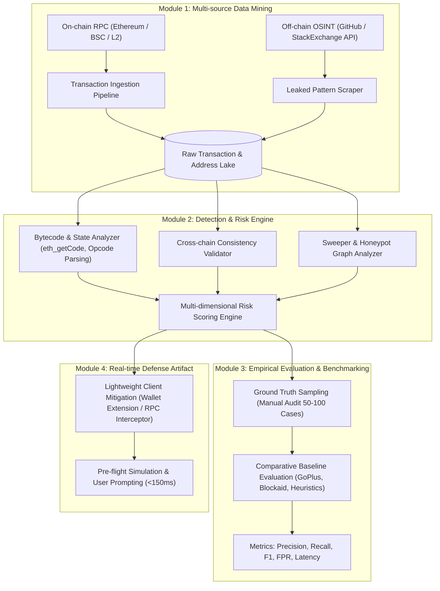

# KẾ HOẠCH NGHIÊN CỨU KHOA HỌC & BÀI BÁO HỘI NGHỊ
## Đề tài: Phát Hiện Địa Chỉ Blockchain Bị Dùng Sai (Address Misuse) và Đánh Giá Rủi Ro Bảo Mật Trên Hệ Sinh Thái EVM

> ### 📋 NGUYÊN VĂN ĐỀ BÀI ĐƯỢC GIAO
> **Đề tài**: Blockchain Address Misuse: phát hiện địa chỉ hợp đồng/EOA bị dùng sai và nguy cơ mất tài sản  
> **Yêu cầu & Hướng đi**: Tái lập một subset của nghiên cứu Address Misuse trên Ethereum/BSC hoặc testnet: phân loại CA Misuse và EOA Misuse, xây rule/transaction-pattern detector và kiểm chứng bằng manual audit. Có thể khai thác dữ liệu GitHub/Stack Exchange ở quy mô nhỏ nhưng tuyệt đối không sử dụng private key thật để chuyển tài sản. Cải tiến: cross-chain address consistency, cảnh báo wallet-side, hoặc model xếp hạng risk.  
> **Paper tham chiếu gốc**: *Lost in Blockchain Address Misuse: Hidden Cross-Platform Risks and Their Security Impact* — USENIX Security 2026 (Hạng A*)  
> **Link bài báo gốc**: [https://www.usenix.org/conference/usenixsecurity26/presentation/shao-zhenzhe](https://www.usenix.org/conference/usenixsecurity26/presentation/shao-zhenzhe)

---

## 🎯 1. ĐỊNH HƯỚNG BÀI BÁO KHOA HỌC (PAPER SCOPE & TARGETS)

* **Loại hình nghiên cứu**: Bài báo nghiên cứu thực nghiệm & phòng thủ an ninh mạng (Empirical Security & Defense Paper).
* **Mục tiêu xuất bản**: Hội nghị khoa học chuyên ngành CNTT/An toàn thông tin (ví dụ: các hội nghị IEEE/ACM, ARES, SoICT, hoặc track bảo mật Web3/Cybersecurity quốc tế).
* **Tiêu chuẩn đóng góp học thuật (Academic Contributions)**:
  1. **Hệ thống hóa phân loại rủi ro (Formal Taxonomy)**: Phân loại chi tiết và định nghĩa toán học/máy trạng thái về *CA Misuse*, *EOA Misuse*, và đặc biệt là *Cross-Chain Address Misalignment*.
  2. **Tập dữ liệu kiểm chứng mở (Curated Ground-Truth Benchmark)**: Đóng góp một dataset có dán nhãn (labeled dataset) các giao dịch và địa chỉ bị misuse trên Ethereum, BSC và L2 (Arbitrum/Optimism).
  3. **Khung phát hiện & Định lượng rủi ro (Novel Detection & Risk Scoring Framework)**: Đề xuất một thuật toán phát hiện kết hợp On-chain Bytecode/State Tracing và Off-chain Intelligence, có công thức tính điểm rủi ro $RiskScore \in [0, 100]$.
  4. **Giải pháp phòng vệ thời gian thực (Client-side Mitigation Artifact)**: Xây dựng một PoC hoàn chỉnh (RPC Proxy / Wallet Plugin) có khả năng chặn giao dịch sai lầm trong thời gian thực với độ trễ $< 150\text{ ms}$.

---

## 🔬 2. CÂU HỎI NGHIÊN CỨU (RESEARCH QUESTIONS - RQs)

Mọi thí nghiệm và kết quả trong paper sẽ được thiết kế để trả lời 3 câu hỏi nghiên cứu cốt lõi:

* **RQ1 (Thực trạng & Quy mô - Measurement)**:
  * *Tần suất xuất hiện và quy mô thiệt hại thực tế của tình trạng nhầm lẫn địa chỉ (CA & EOA Misuse) trên các mạng EVM hiện nay là bao nhiêu?*
  * *Tỷ lệ token/native coin bị khóa vĩnh viễn (black hole) phân bổ thế nào giữa các loại contract (ERC-20, NFT, Proxy uninitialized)?*
* **RQ2 (Cơ chế & Kỹ thuật tấn công - Root Cause & Exploit Vectors)**:
  * *Đâu là nguyên nhân gốc rễ (sự khác biệt `CREATE2` xuyên chuỗi, thiếu hàm `fallback()`, ví lộ key trên GitHub)?*
  * *Các tác nhân xấu (adversaries / sweeper bots) khai thác hiện tượng này để trục lợi ra sao (front-running, address poisoning, phishing)?*
* **RQ3 (Hiệu quả & Khả năng phòng vệ - Effectiveness & Overhead)**:
  * *Mô hình phát hiện đề xuất đạt Precision, Recall, F1-score và False Positive Rate (FPR) là bao nhiêu khi so sánh với các baseline hiện nay?*
  * *Giải pháp cảnh báo phía ví có thể triển khai với độ trễ (latency overhead) và chi phí tài nguyên có chấp nhận được trong môi trường thực tế không?*

---

## 🏛️ 3. MÔ HÌNH HỆ THỐNG & PHƯƠNG PHÁP NGHIÊN CỨU (METHODOLOGY)

### 3.1. Phân loại kỹ thuật chi tiết (Misuse Taxonomy)

1. **CA Misuse (Nhầm lẫn địa chỉ Hợp đồng)**:
   * *Type 1 (Non-Contract Address as CA)*: Gọi hàm tới địa chỉ EOA hoặc địa chỉ rỗng (`getCode == 0x`), giao dịch không revert nhưng hoàn toàn vô tác dụng.
   * *Type 2 (No-Withdraw Trap / Black Hole)*: Chuyển ETH/BNB vào contract có `receive()` hoặc `fallback()` payable nhưng **không có bất kỳ hàm `withdraw()` hoặc logic giải phóng tài sản nào**.
   * *Type 3 (Token Self-Transfer Sink)*: Người dùng gửi Token A trực tiếp vào chính địa chỉ Contract của Token A thay vì ví nhận $\rightarrow$ Token bị kẹt vĩnh viễn trong hợp đồng.
   * *Type 4 (Cross-Chain Address Misalignment - Điểm mới)*: Contract tồn tại trên Ethereum L1, người dùng gửi tiền vào cùng địa chỉ đó trên BSC hoặc Arbitrum nhưng trên chuỗi đích địa chỉ này vẫn chưa được khởi tạo (`getCode == 0x`).

2. **EOA Misuse (Nhầm lẫn địa chỉ Cá nhân)**:
   * *Type 5 (Publicly Compromised Private Key)*: Địa chỉ ví bị lộ private key trên GitHub/StackOverflow; kẻ tấn công cài đặt bot rút tiền tự động (Sweeper Bots) liên tục lắng nghe mempool.
   * *Type 6 (Address Poisoning / Vanity Collision)*: Địa chỉ kẻ tấn công giả mạo (trùng 4 ký tự đầu và 4 ký tự cuối) lợi dụng tính năng copy-paste lịch sử ví của người dùng.

### 3.2. Công thức định lượng điểm rủi ro (Risk Scoring Formulation)
Mô hình đề xuất tính toán điểm số rủi ro $R(A, C)$ của một địa chỉ $A$ trên mạng blockchain $C$ theo trọng số đa chiều:

$$R(A, C) = w_1 \cdot S_{\text{bytecode}}(A, C) + w_2 \cdot S_{\text{cross-chain}}(A) + w_3 \cdot S_{\text{osint}}(A) + w_4 \cdot S_{\text{history}}(A)$$

* Trong đó:
  * $S_{\text{bytecode}} \in [0, 1]$: Điểm rủi ro phân tích cấu trúc mã (thiếu hàm withdraw, thiếu payable, uninitialized proxy).
  * $S_{\text{cross-chain}} \in [0, 1]$: Độ lệch bytecode giữa chain hiện tại với các chain khác ($1.0$ nếu là contract trên chain gốc nhưng rỗng trên chain đích).
  * $S_{\text{osint}} \in [0, 1]$: Tần suất và ngữ cảnh xuất hiện của địa chỉ trong mã nguồn công khai (GitHub leaks).
  * $S_{\text{history}} \in [0, 1]$: Tỷ lệ giao dịch revert hoặc bị rút tiền tức thì bởi sweeper bot.
  * $w_1, w_2, w_3, w_4$: Trọng số tối ưu hóa dựa trên thực nghiệm.

---

## 🛡️ 4. NGUYÊN TẮC ĐẠO ĐỨC & TRÁCH NHIỆM KHOA HỌC (ETHICAL & DISCLOSURE POLICY)

Bài báo khoa học bắt buộc phải có mục **Ethical Considerations**:
* **Không xâm phạm tài sản (No Asset Transfer)**: Nghiêm cấm tuyệt đối hành vi dùng private key tìm thấy trên mạng để ký giao dịch hoặc chuyển tài sản của bất kỳ ai. Mọi phân tích chỉ thực hiện thụ động trên dữ liệu lịch sử on-chain công khai.
* **Bảo mật danh tính (Data Anonymization)**: Khi trình bày các trường hợp nghiên cứu điển hình (Case Studies) trong bài báo, các địa chỉ ví cá nhân phải được ẩn danh một phần (ví dụ: `0x71C...49b6`).
* **Báo cáo trách nhiệm (Responsible Disclosure)**: Nếu phát hiện các lỗ hổng hệ thống hoặc các hợp đồng giữ lượng tài sản lớn bị kẹt do lỗi lập trình, nhóm sẽ lập báo cáo bảo mật gửi cho đội ngũ phát triển dự án trước khi công bố bài báo.

---

## 📑 5. BỐ CỤC CHUẨN CỦA BÀI BÁO KHOA HỌC (CONFERENCE PAPER STRUCTURE)

Bài báo sẽ được soạn thảo bằng **LaTeX** (template chuẩn IEEE Conference hoặc ACM Master Article):

* **Title**: *Characterizing and Mitigating Address Misuse Risks in Cross-Chain EVM Ecosystems* (hoặc tựa đề tương đương)
* **Abstract** (200–250 từ): Tóm tắt bối cảnh, vấn đề, phương pháp, kết quả định lượng (Precision, tài sản bảo vệ) và đóng góp chính.
* **Section 1: Introduction**: Bối cảnh account-based blockchain, tính bất biến, bài toán Address Misuse, các thách thức kỹ thuật, 3 câu hỏi nghiên cứu (RQs), tóm tắt các đóng góp (Contributions).
* **Section 2: Background & Threat Model**:
  * 2.1. Cấu trúc tài khoản EVM: EOA vs Contract Account, cơ chế sinh địa chỉ (`CREATE` vs `CREATE2`).
  * 2.2. Threat Model: Định nghĩa các tác nhân (Người dùng vô ý, Kẻ tấn công chủ động, Sweeper bots).
* **Section 3: Taxonomy & Empirical Measurement (Trả lời RQ1 & RQ2)**:
  * Phân loại 6 dạng lỗi Misuse; thống kê quy mô giao dịch và lượng ETH/BNB bị thất thoát.
  * Phân tích 2 kịch bản tấn công thực tế (Case Studies).
* **Section 4: Proposed Framework: Detection & Mitigation Engine**:
  * Thiết kế thuật toán phân tích bytecode on-chain.
  * Cơ chế đối soát xuyên chuỗi (Cross-chain Verification).
  * Công thức chấm điểm rủi ro $RiskScore$.
  * Kiến trúc Wallet-side Interceptor / RPC Proxy.
* **Section 5: Experimental Evaluation (Trả lời RQ3)**:
  * 5.1. Dataset & Setup: Quy mô dữ liệu, phương pháp Temporal Split.
  * 5.2. Detection Performance: Đo Precision, Recall, F1, False Positive Rate (so sánh với baseline).
  * 5.3. Manual Audit Validation: Kết quả kiểm chứng độc lập trên 100 mẫu.
  * 5.4. Performance & Latency Benchmark: Đo độ trễ khi chặn giao dịch (ms), mức tiêu thụ CPU/RAM của extension.
* **Section 6: Discussion & Limitations**: Các trường hợp né tránh (evasion techniques) tiềm ẩn, hạn chế của việc phân tích tĩnh.
* **Section 7: Ethical Considerations & Responsible Disclosure**: Đảm bảo chuẩn mực an toàn thông tin.
* **Section 8: Related Work**: So sánh với các nghiên cứu trước đây (Shao et al. USENIX '26, smart contract auditing, phishing detection).
* **Section 9: Conclusion**: Tóm lược kết quả và hướng phát triển tương lai.

---

## 📅 6. LỘ TRÌNH THỰC HIỆN NGHIÊN CỨU & HOÀN THIỆN PAPER (10 TUẦN - TỐI ƯU HÓA)

| Giai đoạn | Thời gian | Nhiệm vụ khoa học trọng tâm (Ponytail Optimized) | Sản phẩm đầu ra (Research Artifacts) |
| :---: | :---: | :--- | :--- |
| **Sprint 1** | **Tuần 1–2** | **Cơ sở lý thuyết, Phân tích Paper & Khung bài báo** • Phân tích sâu cơ chế EVM State, `CREATE`/`CREATE2`, và EIP-7702 trong paper USENIX '26 • Dựng khung bài báo chuẩn IEEE 2-column trên Overleaf • Chuẩn hóa Taxonomy 6 dạng Misuse và Threat Model | Khung bài báo LaTeX (`draft_v1.pdf`) + Bảng đặc tả toán học Taxonomy. |
| **Sprint 2** | **Tuần 3–4** | **Chuẩn hóa Dataset từ Zenodo & Mô phỏng Fork** • Trích xuất và dán nhãn 2.000 mẫu Ground-truth từ Zenodo (`records/17984167`) • Mini-scraper Python thu thập 1.000 key mới từ GitHub OSINT • Dựng Foundry Anvil Fork mô phỏng kịch bản Aave 2.580 ETH & EIP-7702 Sweeper | Dataset chuẩn (`data/ground_truth.jsonl`) + Script kiểm thử tái hiện thành công trên Anvil. |
| **Sprint 3** | **Tuần 5–6** | **Xây dựng Detection Engine & Risk Scoring** • Xây dựng Core Bytecode Analyzer dùng `pyevmasm` (nhận diện Black Hole, uninitialized proxy, EIP-7702) • Cài đặt Cross-Chain Consistency Validator (`eth_getCode` song song) • Hiện thực hóa công thức tính điểm $R(A,C) \in [0, 100]$ | Module Python `src/engine/` hoàn chỉnh kèm 100% unit tests `pytest` đạt pass. |
| **Sprint 4** | **Tuần 7–8** | **Triển khai RPC Proxy Interceptor & Đánh giá Thực nghiệm** • Xây dựng Local RPC Proxy bằng FastAPI (chặn giao dịch nguy hiểm, đo latency < 150ms) • Chạy thực nghiệm định lượng 200 mẫu, so sánh đối đầu với GoPlus Security API • Đo đạc Precision, Recall, F1, FPR và kiểm chứng thủ công 50 ca biên | Mã nguồn RPC Proxy + `Dockerfile` + Bảng số liệu thực nghiệm & ROC Curve. |
| **Sprint 5** | **Tuần 9–10** | **Hoàn thiện Bài báo, Camera-ready & Báo cáo** • Hoàn thiện các phần Evaluation, Discussion, Ethical Considerations, Related Work • Đóng gói Docker Compose 1-click chạy toàn bộ test & benchmark • Soạn Slide thuyết trình khoa học (15–20 slides) & Video demo 3–5 phút | Bản thảo bài báo hoàn chỉnh (PDF LaTeX) + Dockerized Artifact + Slide & Video. |

---

## 📦 7. DANH MỤC SẢN PHẨM BẮT BUỘC ĐỂ BẢO VỆ / NỘP HỘI NGHỊ

1. **Full Research Paper (PDF)**: Bài báo khoa học chuẩn định dạng IEEE/ACM (khoảng 6–10 trang 2 cột), giải quyết trọn vẹn 3 RQs, đầy đủ chứng minh, bảng biểu và trích dẫn BibTeX.
2. **Reproducible Research Artifact**:
   * Repository mã nguồn sạch trên GitHub kèm `docker-compose.yml` 1-click.
   * Dataset chuẩn đã ẩn danh hóa và dán nhãn (Open Benchmark tích hợp từ Zenodo).
3. **Interactive PoC Interceptor**: Local RPC Proxy (FastAPI) kết nối trực tiếp với MetaMask, can thiệp thời gian thực với độ trễ cộng thêm $< 150\text{ ms}$.
4. **Presentation Slide Deck & Demo Video**: Slide thuyết trình khoa học mạch lạc + Video demo kịch bản tấn công và cơ chế ngăn chặn.
