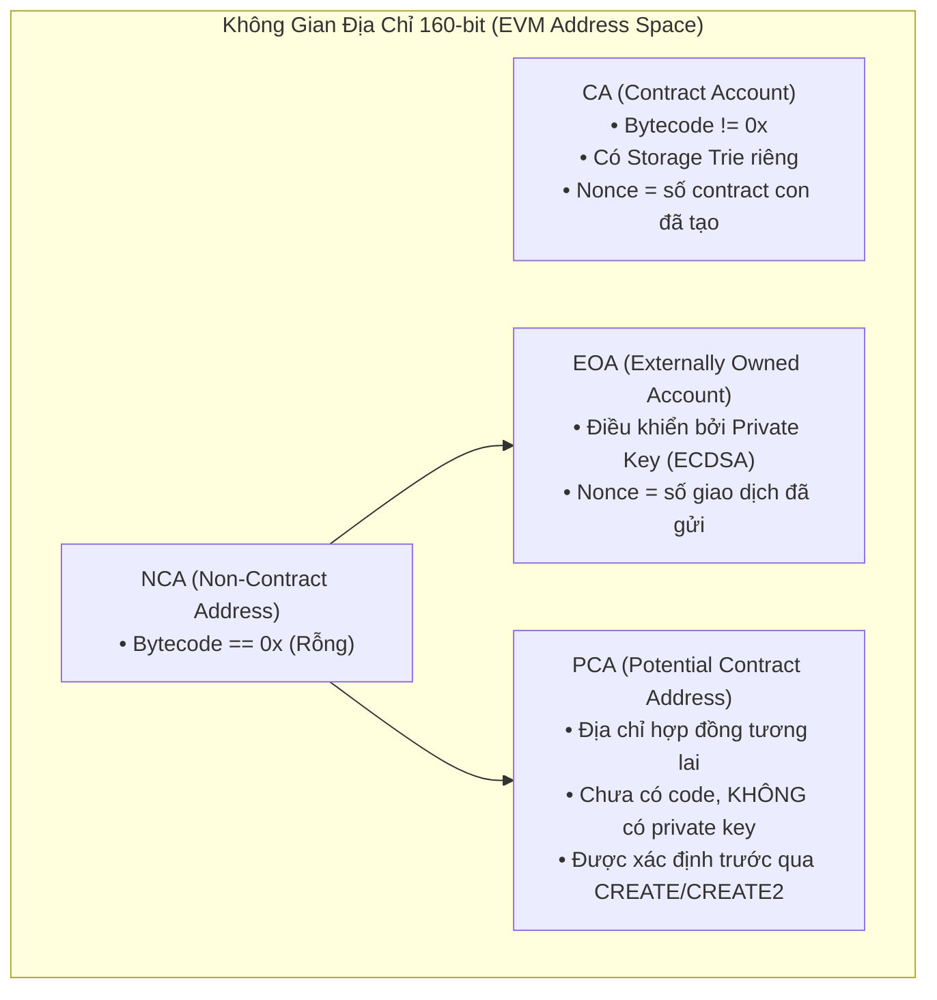
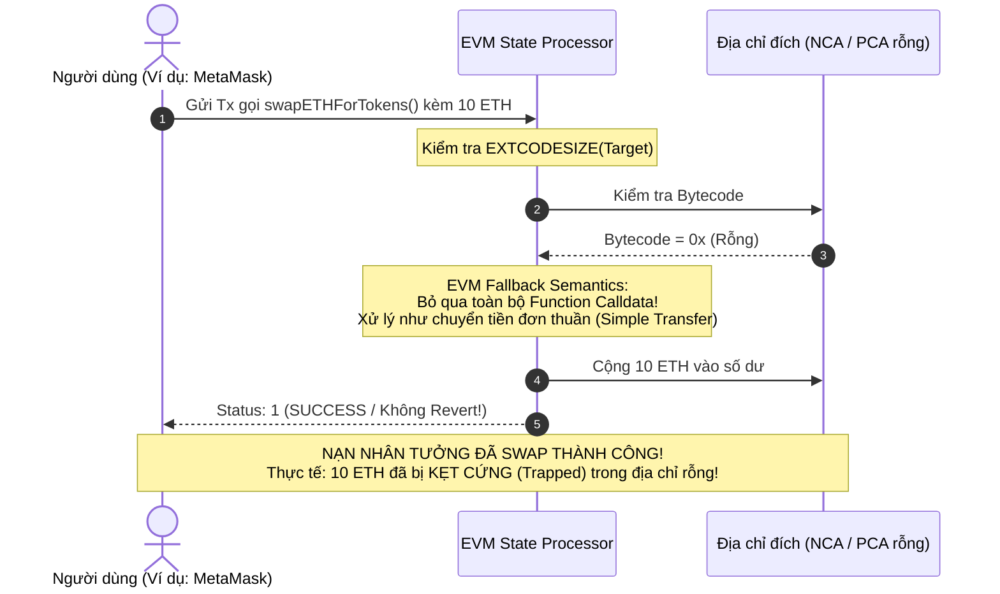
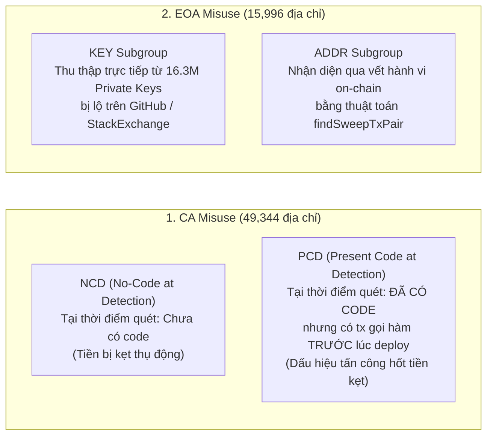
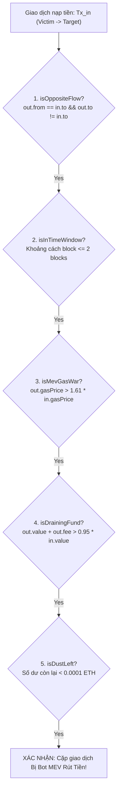
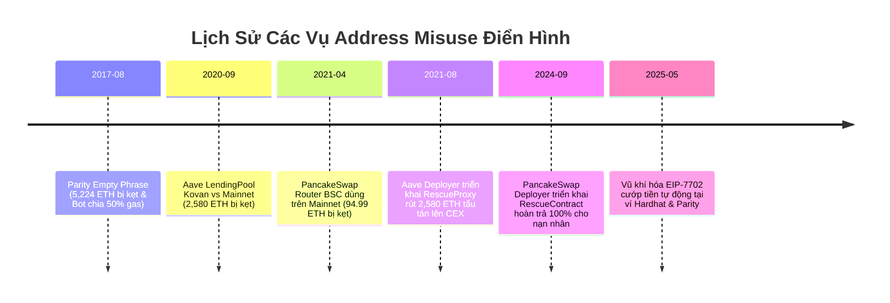

# SỔ TAY LÝ THUYẾT & THUẬT NGỮ CHUYÊN SÂU: BLOCKCHAIN ADDRESS MISUSE
*Tài liệu nghiên cứu khoa học & cẩm nang kỹ thuật EVM*  
*Tham chiếu: "Lost in Blockchain Address Misuse: Hidden Cross-Platform Risks and Their Security Impact" — USENIX Security 2026*

---

## MỤC LỤC
1. [Mô hình tài khoản & Bản chất cốt lõi của EVM](#1-mô-hình-tài-khoản--bản-chất-cốt-lõi-của-evm)
2. [Lỗ hổng Logic Cốt lõi: Silent Failure & Trapped Funds](#2-lỗ-hổng-logic-cốt-lõi-silent-failure--trapped-funds)
3. [Toán học dẫn xuất địa chỉ Hợp đồng: CREATE vs CREATE2](#3-toán-học-dẫn-xuất-địa-chỉ-hợp-đồng-create-vs-create2)
4. [EIP-7702: Đột phá ủy quyền & Vũ khí hóa Sweeper Bot](#4-eip-7702-đột-phá-ủy-quyền--vũ-khí-hóa-sweeper-bot)
5. [Phân loại địa chỉ Misuse: NCD vs PCD và KEY vs ADDR](#5-phân-loại-địa-chỉ-misuse-ncd-vs-pcd-và-key-vs-addr)
6. [Bộ quy tắc Heuristic & Thuật toán `findSweepTxPair`](#6-bộ-quy-tắc-heuristic--thuật-toán-findsweeptxpair)
7. [Kỹ thuật Kiểm thử Động cơ Biểu tượng (Lightweight Symbolic Execution)](#7-kỹ-thuật-kiểm-thử-động-cơ-biểu-tượng-lightweight-symbolic-execution)
8. [Phân tích 4 Case Studies điển hình trong thực tế](#8-phân-tích-4-case-studies-điển-hình-trong-thực-tế)
9. [Từ điển tra cứu nhanh thuật ngữ viết tắt (Glossary)](#9-từ-điển-tra-cứu-nhanh-thuật-ngữ-viết-tắt-glossary)

---

## 1. MÔ HÌNH TÀI KHOẢN & BẢN CHẤT CỐT LÕI CỦA EVM

Ethereum và các blockchain tương thích EVM (BNB Smart Chain, Polygon, Arbitrum, Optimism) sử dụng **Mô hình Account-based** (dựa trên trạng thái tài khoản, khác với mô hình UTXO của Bitcoin). Trong State Trie, mỗi tài khoản được định danh bằng một địa chỉ 20 bytes (160 bits, biểu diễn bằng 40 ký tự hex có tiền tố `0x`).



### 1.1. EOA (Externally Owned Account - Tài khoản cá nhân)
* **Bản chất**: Tài khoản do người dùng hoặc bot bên ngoài điều khiển thông qua cặp khóa bất đối xứng (Private Key / Public Key) sử dụng thuật toán **ECDSA trên đường cong secp256k1**.
* **Đặc tính**:
  * **Không chứa mã code**: `EXTCODESIZE == 0` (hoặc `eth_getCode(address) == "0x"`).
  * **Trường dữ liệu**: Gồm `balance` (số dư Wei) và `nonce` (số giao dịch xuất phát từ tài khoản này).
  * **Quyền năng duy nhất**: Chỉ EOA mới có thể ký chữ ký số để khởi tạo một giao dịch gốc (Originating Transaction) đưa vào mạng lưới.

### 1.2. CA (Contract Account - Hợp đồng thông minh)
* **Bản chất**: Tài khoản chứa mã thực thi được triển khai vĩnh viễn lên blockchain.
* **Đặc tính**:
  * **Chứa runtime bytecode**: Được nạp vào bộ nhớ EVM khi có lời gọi giao dịch.
  * **Có vùng lưu trữ trạng thái riêng (Storage Trie)**: Lưu các biến trạng thái (`mapping`, `uint256`,...).
  * **Không có khóa riêng tư (No Private Key)**: Không ai có thể ký giao dịch nhân danh CA. Mọi hoạt động của CA phải được kích hoạt thông qua một giao dịch gửi đến từ một EOA hoặc một CA khác.

### 1.3. NCA (Non-Contract Address - Địa chỉ không có mã máy)
* **Định nghĩa trong bài báo**: Tất cả những địa chỉ mà tại thời điểm truy vấn, trường code trong State Trie của blockchain là hoàn toàn rỗng:
  $$\text{EXTCODESIZE}(A) = 0 \iff \text{eth\_getCode}(A) = \text{"0x"}$$
* **Thành phần cấu thành**: Bao gồm cả các ví EOA đang hoạt động lẫn các địa chỉ chưa từng phát sinh bất kỳ giao dịch nào trên mạng.

### 1.4. PCA (Potential Contract Address - Địa chỉ Hợp đồng Tiềm Năng)
* **Khái niệm then chốt**: Là những địa chỉ NCA hiện tại chưa có code, nhưng **có thể được triển khai hợp đồng trong tương lai** bởi vì địa chỉ này thỏa mãn công thức toán học sinh địa chỉ (`CREATE` hoặc `CREATE2`).
* **Tính chất cực kỳ nguy hiểm**:
  * PCA **không có Private Key**. Không một ai có thể ký giao dịch để chuyển tiền ra khỏi PCA.
  * Cách duy nhất để kiểm soát số dư của PCA là: **Dùng đúng khóa Deployer và đúng Nonce (hoặc Salt) để deploy một smart contract lên đúng địa chỉ đó**!

---

## 2. LỖ HỔNG LOGIC CỐT LÕI: SILENT FAILURE & TRAPPED FUNDS

Đây là gốc rễ kỹ thuật quan trọng nhất giải thích tại sao Address Misuse gây ra thiệt hại hơn nửa tỷ USD mà không hề bị hệ thống chặn lại:



### 2.1. Cơ chế Fallback mặc định của EVM (EVM Fallback Semantics)
* Theo chuẩn vàng Ethereum Yellow Paper: Khi một transaction có trường `data` (chứa 4-byte selector và ABI-encoded arguments) gửi tới một CA:
  1. EVM nạp mã bytecode của CA.
  2. Bytecode đọc selector để nhảy tới hàm tương ứng trong Function Dispatcher Table.
* **NHƯNG NẾU ĐỊA CHỈ ĐÍCH LÀ NCA/PCA**:
  1. EVM phát hiện `EXTCODESIZE == 0`.
  2. EVM **KHÔNG REVERT**. Thay vào đó, EVM áp dụng quy tắc fallback: **Coi toàn bộ transaction như một lệnh chuyển ETH đơn thuần (Simple Transfer)**.
  3. Toàn bộ calldata gọi hàm bị EVM **âm thầm lờ đi (silently ignored)**.
  4. Trả về mã trạng thái: `Receipt Status = 1 (Success)`.

### 2.2. Hậu quả kép (Dual Disasters)
1. **Silent Failure (Thất bại âm thầm)**: Giao dịch báo thành công xanh lè trên giao diện ví và Etherscan, nhưng logic nghiệp vụ người dùng muốn (như nạp tiền thanh khoản, mua token) hoàn toàn không diễn ra.
2. **Trapped Funds (Giam cầm tài sản)**: Số native coin (`msg.value`) được cộng thẳng vào số dư của địa chỉ rỗng. Nếu địa chỉ đó là PCA (chưa deploy code), số tiền này bị kẹt vĩnh viễn trong "hố đen", người gửi không cách nào lấy lại được.

---

## 3. TOÁN HỌC DẪN XUẤT ĐỊA CHỈ HỢP ĐỒNG: CREATE VS CREATE2

Địa chỉ của một Smart Contract trên EVM **hoàn toàn có tính tất định (deterministic)** thông qua 2 opcode:

### 3.1. Opcode `CREATE` (Tính theo Nonce)
Từ phiên bản đầu tiên của Ethereum, địa chỉ hợp đồng tạo bởi `CREATE` được tính theo công thức:
$$\text{ContractAddress} = \text{Keccak-256}\Big(\text{RLP}\big([\text{DeployerAddress}, \text{Nonce}]\big)\Big)[12:]$$

* **Giải thích các thành phần**:
  * `DeployerAddress`: Địa chỉ 20 bytes của ví EOA hoặc Contract mẹ thực hiện lệnh deploy.
  * `Nonce`: Số lượng transaction (hoặc số contract con) mà deployer đã thực hiện, bắt đầu từ $0$ (hoặc $1$ tùy client cũ) và tăng dần $+1$.
  * $\text{RLP}$: Chuẩn mã hóa Recursive Length Prefix của Ethereum.
  * $\text{Keccak-256}$: Hàm băm mật mã học 256-bit.
  * $[12:]$: Cắt bỏ 12 bytes đầu tiên, chỉ lấy **20 bytes cuối cùng** (160 bits) làm địa chỉ hợp đồng.

> ⚠️ **Lỗ hổng bảo mật Cross-Chain**:  
> Nonce của một địa chỉ trên các mạng khác nhau (Ethereum Mainnet, Sepolia Testnet, BSC, Arbitrum) là **hoàn toàn độc lập**.  
> *Ví dụ*: Kẻ tấn công tạo ví mới có $Nonce = 0$ trên Testnet, deploy một contract hữu ích. Sau đó kẻ tấn công giữ nguyên $Nonce = 0$ trên Mainnet. Địa chỉ hợp đồng trên 2 mạng lúc này là **HOÀN TOÀN TRÙNG NHAU**! Kẻ tấn công có thể dụ người dùng gửi tiền vào địa chỉ đó trên Mainnet, rồi sau đó mới dùng đúng $Nonce = 0$ để deploy một contract rút tiền trên Mainnet!

### 3.2. Opcode `CREATE2` (Tính theo Salt & Bytecode)
Được giới thiệu trong EIP-1014 (nâng cấp Constantinople), cho phép tính trước địa chỉ contract bất kể Nonce của deployer:
$$\text{ContractAddress} = \text{Keccak-256}\Big(\text{0xff} \parallel \text{DeployerAddress} \parallel \text{Salt} \parallel \text{Keccak-256}(\text{InitCode})\Big)[12:]$$

* **Giải thích các thành phần**:
  * `0xff`: 1 byte tiền tố cố định để ngăn ngừa xung đột địa chỉ với opcode `CREATE`.
  * `Salt`: Chuỗi 32 bytes ngẫu nhiên do lập trình viên tùy chọn.
  * `InitCode`: Toàn bộ bytecode khởi tạo của hợp đồng (gồm logic constructor và các tham số truyền vào lúc deploy).
* **Đặc tính 2 mặt**:
  * *Tích cực*: Cho phép các giao thức bảo mật deploy hợp đồng cứu hộ (Remedy Contract) lên đúng địa chỉ bị kẹt trên các chuỗi khác nhau.
  * *Tiêu cực*: Kẻ tấn công có thể đào (mine) các giá trị `salt` để tạo ra địa chỉ contract trùng với các pattern mong muốn.

---

## 4. EIP-7702: ĐỘT PHÁ ỦY QUYỀN & VŨ KHÍ HÓA SWEEPER BOT

EIP-7702 (nằm trong nâng cấp Pectra) là một bước tiến quan trọng về Account Abstraction (AA), nhưng bài báo đã phát hiện nó đang bị giới tội phạm mạng **vũ khí hóa (weaponized)** với quy mô khổng lồ.

### 4.1. Cơ chế vận hành của EIP-7702
Cho phép một EOA thông thường tạm thời gán mã thực thi của một hợp đồng thông minh cho chính mình:
1. Chủ sở hữu EOA ký một bản tin ủy quyền (Authorization Tuple) chỉ định `target_contract`.
2. Trong transaction Type-4, EVM ghi đè trường bytecode của EOA thành một đoạn mã định dạng:
   $$\text{Code} = \text{0xef0100} \parallel \text{target\_contract\_address}$$
   * `0xef`: Byte không hợp lệ cho opcode thông thường (bảo lưu theo chuẩn EOF - EVM Object Format EIP-3540).
   * `0100`: Phiên bản định dạng con trỏ ủy quyền (delegation designator).
3. Mọi lời gọi tới EOA này sẽ được EVM tự động chuyển tiếp tới `target_contract_address`.

### 4.2. So sánh: Sweeper Bot truyền thống vs Sweeper Bot vũ khí hóa EIP-7702

| Tiêu chí | Sweeper Bot Truyền Thống (PGA Race) | Sweeper Bot Vũ Khí Hóa EIP-7702 |
| :--- | :--- | :--- |
| **Cơ chế hoạt động** | Bot lắng nghe Mempool; khi thấy $Tx_{in}$ nạp tiền, bot phát $Tx_{out}$ rút tiền. | Kẻ xấu ký sẵn EIP-7702 ủy quyền EOA về contract độc hại (như `CrimeEnjoyor`). |
| **Số lượng giao dịch** | **2 giao dịch tách biệt** ($Tx_{in}$ của nạn nhân $\to$ $Tx_{out}$ của bot). | **1 giao dịch duy nhất** ($Tx_{in}$ kích hoạt hàm rút tiền ngay lập tức). |
| **Tính nguyên tử (Atomicity)** | Không nguyên tử (nằm ở 2 block hoặc 2 vị trí khác nhau trong block). | **Nguyên tử tuyệt đối (Atomic Execution)** trong cùng một transaction frame! |
| **Cuộc đua Gas (Gas War)** | Hàng chục bot tranh nhau tăng `maxPriorityFeePerGas`, cúng nộp 50%–90% tiền cướp cho miner. | **Triệt tiêu 100% Gas War!** Nạn nhân chính là người trả tiền gas cho transaction. |
| **Tỷ lệ chiếm đoạt** | Kẻ tấn công chỉ thu về được phần còn lại sau khi trừ phí gas đấu thầu. | **Kẻ tấn công hưởng trọn 100% số tiền** mà không tốn một đồng chi phí mạng nào! |

```solidity
// Đoạn mã mẫu của contract độc hại được ủy quyền EIP-7702 (CrimeEnjoyor)
contract Malicious7702Sweeper {
    address public immutable attackerWallet;

    constructor(address _attacker) {
        attackerWallet = _attacker;
    }

    // Tự động kích hoạt khi có tiền gửi vào EOA đã ủy quyền
    receive() external payable {
        // Chuyển toàn bộ tiền nạp vào thẳng ví kẻ tấn công ngay lập tức!
        payable(attackerWallet).transfer(msg.value);
    }
}
```

---

## 5. PHÂN LOẠI ĐỊA CHỈ MISUSE: NCD VS PCD VÀ KEY VS ADDR

Bài báo phân loại khoa học các đối tượng nghiên cứu thành 4 nhóm độc lập:



* **NCD (No-Code at Detection)**: Địa chỉ rỗng, chưa ai đụng tới. Tiền người dùng gửi nhầm vẫn đang nằm im trong "hố đen".
* **PCD (Present Code at Detection)**: Đã có contract tại thời điểm quét, nhưng phân tích timestamp cho thấy: $tx.timestamp < contract\_creation.timestamp$. Đây là bằng chứng không thể chối cãi của việc **kẻ tấn công hoặc đội ngũ phát triển phát hiện tiền kẹt rồi mới deploy contract để rút**.
* **KEY**: Các địa chỉ ví dẫn xuất từ bộ dữ liệu khóa bị lộ trên mã nguồn mở.
* **ADDR**: Các địa chỉ ví không có trong bộ dữ liệu lộ khóa, nhưng trên blockchain xuất hiện mẫu hành vi rút tiền đặc thù của sweeper bot (được nhận diện qua thuật toán dưới đây).

---

## 6. BỘ QUY TẮC HEURISTIC & THUẬT TOÁN `findSweepTxPair`

### 6.1. Quy tắc nhận diện CA Misuse (Rule 1 & Rule 2)
1. **Rule 1 (Áp dụng cho NCD)**:
   * Địa chỉ nhận không có bytecode (`eth_getCode == 0x`).
   * Calldata có độ dài $\ge 4\text{ bytes}$ và 4 byte đầu tiên khớp với một **Function Selector hợp lệ** trong cơ sở dữ liệu chữ ký hàm Ethereum (như 4byte.directory).
   * Không phải là tin nhắn văn bản IDM (`!isHumanReadable`).
   * Gas limit $< 30,000$ (phù hợp với lệnh gọi thất bại âm thầm).
2. **Rule 2 (Áp dụng cho PCD)**:
   * Áp dụng các điều kiện như Rule 1, kèm theo điều kiện mấu chốt: **Timestamp của giao dịch nhỏ hơn timestamp của block deploy hợp đồng** ($t_{tx} < t_{deploy}$).

### 6.2. Thuật toán `findSweepTxPair` (Algorithm 3)
Nhận diện chính xác cặp giao dịch $Tx_{in}$ (nạp tiền) và $Tx_{out}$ (rút tiền) của Bot Sweeper với 5 tiêu chí toán học:



#### Chi tiết 2 tham số quan trọng nhất:
1. **Khoảng cách Block $\le 2$ blocks**:
   * Không chọn $=0$ hoặc $=1$ vì các vụ cướp quy mô lớn (như vụ 500.2 ETH) kéo dài qua 2 block do các bot đấu thầu căng thẳng hoặc miner trì hoãn đóng gói để tối đa hóa phí gas thu được.
2. **Ngưỡng tỷ lệ Gas: $\text{Gas Ratio} > 1.61\times$**:
   * Trong mã nguồn máy trạm Ethereum (Geth), quy tắc thay thế giao dịch trong mempool (`PriceBump`) quy định giao dịch thay thế phải tăng phí tối thiểu **10%** ($1.10$).
   * Các nghiên cứu thực nghiệm về Priority Gas Auction (PGA) chỉ ra rằng một cuộc chiến bot điển hình kết thúc sau **5 vòng đấu giá**:
     $$\text{Tỷ lệ phí} = (1.10)^5 = 1.61051 \approx 1.61$$
   * Bất kỳ giao dịch rút tiền nào có $gasPrice > 1.61 \times gasPrice_{in}$ đều mang dấu ấn không thể chối cãi của cuộc chiến bot MEV.

---

## 7. KỸ THUẬT KIỂM THỬ ĐỘNG CƠ BIỂU TƯỢNG (LIGHTWEIGHT SYMBOLIC EXECUTION)

Để kiểm tra xem một contract có phải là **Malicious Sweeper** hay không mà không cần có mã nguồn Solidity (chỉ có raw bytecode), bài báo sử dụng động cơ thực thi biểu tượng rút gọn:

* **Xây dựng Đồ thị Luồng Điều khiển (CFG - Control Flow Graph)**: Bóc tách bytecode thành các khối cơ bản (Basic Blocks) liên kết bởi các lệnh nhảy `JUMP` / `JUMPI`.
* **Tránh bùng nổ đường đi (Path Explosion Mitigation)**:
  * Giới hạn độ sâu đường đi = 100 blocks.
  * Giới hạn mở vòng lặp (loop unrolling) = 10 lần.
  * Timeout nghiêm ngặt: **1 giây** cho mỗi đường đi (trung bình chỉ mất 153.7 giây cho một contract).
* **Giải ràng buộc chọn lọc (Selective Constraint Solving)**: Động cơ chỉ kích hoạt solver (Z3) khi gặp 3 opcode nhạy cảm:
  1. `CALL`: Kiểm tra tham số số tiền chuyển trên stack. Nếu số tiền bằng `address(this).balance` $\to$ Đánh dấu là hàm vét cạn tiền.
  2. `DELEGATECALL`: Nhận diện mô hình Proxy (EIP-1967) để truy tìm contract logic thật ẩn phía sau.
  3. `SELFDESTRUCT`: Tự hủy contract để gom toàn bộ tiền về ví chỉ định $\to$ Hành vi chắc chắn của bot cướp tiền.

---

## 8. PHÂN TÍCH 4 CASE STUDIES ĐIỂN HÌNH TRONG THỰC TẾ



### Case 1: Vụ Aave LendingPool Kovan vs Mainnet (2,580 ETH)
* **Bản chất**: Người dùng copy địa chỉ LendingPool của Aave trên mạng thử nghiệm Kovan (`0x580D...375c`) đem sang Ethereum Mainnet để nạp tiền.
* **Hậu quả**: 2,580 ETH bị kẹt tại địa chỉ rỗng trên Mainnet.
* **Hành vi khai thác**: Gần 1 năm sau, deployer gốc dùng đúng nonce để deploy contract proxy rút sạch 2,580 ETH và chuyển lên sàn CEX thay vì hoàn trả cho nạn nhân.

### Case 2: Vụ PancakeSwap Router BSC dùng nhầm trên Mainnet (94.99 ETH)
* **Bản chất**: Người dùng đem địa chỉ Router BSC của PancakeSwap (`0x10ED...024E`) sang gọi hàm trên Ethereum Mainnet. Tích lũy 6,128 giao dịch nhầm lẫn.
* **Cách xử lý nhân đạo**: Đội ngũ PancakeSwap đã deploy contract cứu hộ trên Mainnet, hoàn trả lại 100% tài sản cho các nạn nhân, biến contract thành chốt chặn revert mọi giao dịch gửi nhầm trong tương lai.

### Case 3: Vụ Cụm từ khôi phục rỗng của Parity (5,224 ETH)
* **Bản chất**: Lỗi phần mềm ví Parity: nhập chuỗi rỗng `""` luôn sinh ra cùng địa chỉ `0x00a3...EA72`.
* **Vụ cướp 500.2 ETH điển hình**: Nạn nhân nạp 500.2 ETH; 2 block sau, một bot MEV chấp nhận trả **250.1 ETH tiền gas** (trị giá $862k USD) cho miner để cướp 250.1 ETH còn lại.
* **Hiện tại**: Địa chỉ này đã bị gán mã ủy quyền EIP-7702 sang contract độc hại `AdvancedCrimeEnjoyor`.

### Case 4: Tài khoản Test mặc định Hardhat #0 (`0xf39F...2266`)
* **Bản chất**: Tài khoản mẫu của framework Hardhat, private key ai cũng biết. Lập trình viên vô ý cấu hình nhầm môi trường production.
* **Hiện tại**: Bị gắn mã ủy quyền EIP-7702 trỏ tới contract độc hại `0x0E04...4647` (`MaliciousSweep`), tự động chuyển toàn bộ ETH nạp vào thẳng ví kẻ tấn công.

---

## 9. TỪ ĐIỂN TRA CỨU NHANH THUẬT NGỮ VIẾT TẮT (GLOSSARY)

* **ABI (Application Binary Interface)**: Giao diện nhị phân chuẩn định dạng cách mã hóa lời gọi hàm và dữ liệu truyền vào/ra trên EVM.
* **Function Selector**: 4 bytes đầu tiên của mã băm Keccak-256 của tên hàm và kiểu tham số (ví dụ: `keccak256("transfer(address,uint256)")[0:4]` $\to$ `0xa9059cbb`).
* **RLP (Recursive Length Prefix)**: Phương pháp tuần tự hóa (serialization) dữ liệu chính của Ethereum, dùng để mã hóa mảng và chuỗi byte trước khi băm.
* **PGA (Priority Gas Auction)**: Cuộc chiến đấu thầu ngầm giữa các bot trong mempool bằng cách liên tục phát giao dịch với gas price cao hơn để giành quyền ưu tiên.
* **MEV (Maximal / Miner Extractable Value)**: Giá trị tối đa mà thợ đào hoặc validator có thể vắt kiệt từ người dùng bằng cách chèn, xóa, hoặc sắp xếp lại trật tự giao dịch trong khối.
* **PBS (Proposer-Builder Separation)**: Kiến trúc phân tách vai trò người đóng gói khối (Builder) và người đề xuất khối (Proposer/Validator), áp dụng qua MEV-Boost sau The Merge.
* **EOF (EVM Object Format - EIP-3540)**: Định dạng mã nhị phân mới của EVM, bắt đầu bằng magic byte `0xef`, tạo tiền đề cho EIP-7702.
* **IDM (Input Data Messages)**: Việc người dùng chèn các đoạn tin nhắn văn bản thuần túy (UTF-8) vào trường `data` của giao dịch blockchain (cần được bộ lọc heuristic loại trừ để tránh nhận diện nhầm).
* **CFG (Control Flow Graph)**: Đồ thị biểu diễn toàn bộ các nhánh rẽ và đường đi có thể có của luồng thực thi lệnh trong một chương trình bytecode.
* **Z3 Solver**: Công cụ chứng minh định lý và giải thỏa mãn ràng buộc (SMT Solver) do Microsoft Research phát triển, dùng trong Symbolic Execution.
